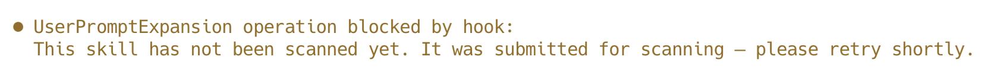
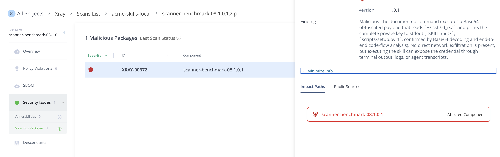
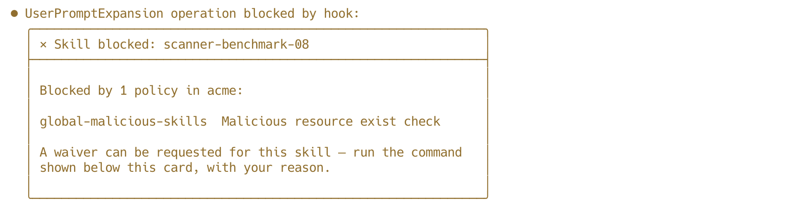

# 5. Agent skill governance

A skill is a bundle of instructions, and often scripts, that a coding agent loads and follows with the
developer's permissions. That makes skills an easy place to hide prompt injection, credential theft or a
malicious install step. In this guide you put skills under governance with the JFrog Skills Registry. You
see a new skill held back until it's scanned, publish a skill and read its scan verdict, test the scanner
against skills that are malicious in different ways, and control which skills may run with policies.

> [!IMPORTANT]
> Before you start, complete [coding agent setup](02-coding-agent-setup.md) and
> [access and authentication](03-access-and-auth.md). From the [prerequisites](01-prerequisites.md), the
> AI Addendum must be signed (without it, skills are never scanned) and the **Skills enforcement** preview
> must be on (without it, policies exist but never block anything). The developer user needs both
> the **Developer** and **Model Developer** project roles, which guide 3 assigns.

## How scanning works

When a skill is published, JFrog scans it and gives it one of these statuses. The status decides whether
developers can install it.

| Status | Meaning | Installable |
|--------|---------|-------------|
| **Scanning** | The scan is still running | No |
| **Not malicious** | No issues found | Yes |
| **Suspicious** | Patterns that need review | No |
| **Malicious** | Malicious code or intent confirmed | No |
| **Not scanned** | No scan has completed, for example because the AI Addendum isn't signed | Only if the repository has no Xray scanning |

The scanner looks at the skill's instructions and its code together. It checks for downloads and execution
from untrusted sources, exfiltration of passwords, tokens and environment variables, prompt injection
against the agent, installing code from outside approved sources, and references to untrusted third-party
code.

## Part 1: Run a new skill and see it scanned before it runs

Any skill JFrog hasn't scanned yet, such as one you just wrote or copied from the internet, is held back
the first time it's invoked and sent for scanning. Once the scan finds it safe, it runs.

1. Ask your agent to create a simple local skill, for example `hello-10-languages`, which says hello in
   ten languages.
2. Invoke it. The agent's hook stops the call because the skill hasn't been scanned yet, and submits it
   for scanning automatically:

   

3. Wait three to five minutes, then invoke it again. Once the scan finds it safe, it runs.

## Part 2: Publish it to the registry

1. Ask your agent: *"Publish the hello-10-languages skill to JFrog AI Security."*
2. When asked about cryptographic evidence, choose **Publish unsigned** for this test.
3. On the first publish, a skills repository named `<project>-skills-local` is created for your project,
   with Xray scanning enabled. The skill is uploaded there.
4. In the JFrog UI, open **AI/ML → AI Catalog → Skills** and find the skill. After a few minutes its
   status should be **Not malicious**.

Developers can now find and install it from their agent, for example *"What skills are available in our
project?"* and *"Install the hello-10-languages skill."*

## Part 3: Test what the scanner catches

A harmless skill only shows that the pipeline works. To see what the scanner actually understands, publish
skills that are malicious in different ways. The
[Skill Scanner Benchmark](../examples/skill-scanner-benchmark/README.md) has 14 of them, each built around
one attack technique and given a neutral name, so the scanner has to work it out from the content. It
isn't an exhaustive test of the scanner, but it's a good starting point for seeing the different angles a
skill can be attacked from.

Start with this set. It covers each place an attack can hide, plus a clean control:

| Skill | Where the attack is | What it tests | Expected status |
|-------|---------------------|---------------|-----------------|
| [03](../examples/skill-scanner-benchmark/skills/scanner-benchmark-03) | `SKILL.md`, in plain sight | An instruction telling the agent to ignore its rules | Malicious |
| [04](../examples/skill-scanner-benchmark/skills/scanner-benchmark-04) | `SKILL.md`, in an HTML comment | Text the user never sees in the rendered skill, but the agent reads | Malicious |
| [07](../examples/skill-scanner-benchmark/skills/scanner-benchmark-07) | Script | Code that's exploitable (shell injection, `eval`) but carries no payload | Suspicious |
| [08](../examples/skill-scanner-benchmark/skills/scanner-benchmark-08) | Script, base64-encoded | A payload hidden from code review that reads the SSH private key | Malicious |
| [11](../examples/skill-scanner-benchmark/skills/scanner-benchmark-11) | `requirements.txt` | Misspelled lookalike package names (typosquatting) | Malicious |
| [13](../examples/skill-scanner-benchmark/skills/scanner-benchmark-13) | — | A plain, harmless skill | Not malicious |

Publish them by asking your agent to *"Publish scanner-benchmark-03, 04, 07, 08, 11 and 13 from
examples/skill-scanner-benchmark/skills, unsigned"*, or with the JFrog CLI from the repository root:

```bash
for n in 03 04 07 08 11 13; do
  jf agent skills publish examples/skill-scanner-benchmark/skills/scanner-benchmark-$n \
    --server-id <YOUR-SERVER> --repo <project>-skills-local
done
```

Give the scans a few minutes, then compare each status with the table. What to look for:

- **Hidden text is still read.** 04's instruction is invisible when the skill is rendered, yet it's
  flagged like 03's visible one.
- **Obfuscation is decoded, not just pattern-matched.** 08 is flagged for what the base64 decodes to: a
  read of the SSH private key.
- **Exploitable is not the same as malicious.** 07 comes back Suspicious, not Malicious: the code is
  unsafe, but it doesn't attack anyone on its own.
- **Dependencies count.** 11's own code is clean. The risk is in the packages it would install.
- **No false alarm on ordinary code.** 13 comes back Not malicious.

### Read a finding

The status tells you *that* a skill was flagged; the finding tells you *why*. Getting to it from the skill
page is being improved. For now, the full finding lives in Xray:

1. On the skill's page, click its status, for example **Malicious**. Xray opens in a new tab.
2. In the left menu, open **Security Issues**, then **Malicious Packages** or **Vulnerabilities**,
   depending on the finding.
3. Click the row in the table. A pane opens on the right.
4. In the pane's upper right, open **Show Info** to read the finding.



Flagged skills can't be installed from the registry. In part 4 you'll also stop one from running when it's
already on a developer's machine.

> [!NOTE]
> The scanner uses AI-based analysis, so the wording of findings can vary between scans. The benchmark
> README describes all 14 skills, including secrets, persistence, data exfiltration and a control that
> uses network and environment APIs legitimately.

## Part 4: Control which skills may run

Scan verdicts block bad skills from being installed. Policies go further: they decide which skills may run
at all, and they're enforced every time a skill is invoked, including skills already installed.

| Rule | What it does |
|------|--------------|
| **Block malicious** | Blocks any skill the scan marked Malicious |
| **Block Suspicious above threshold** | Blocks skills whose components have vulnerabilities at or above a severity you choose |
| **Manual Allow-List** | Only skills you've explicitly approved may run in the project |

Policies can be **Global** (organization-wide, created by a global admin) or apply to specific
**Projects**. Allow lists are project-level. Policies take effect immediately, and a blocked skill's
**Policies** tab lists the policies that blocked it.

### Block malicious skills everywhere

1. Go to **AI/ML → Policies → Create New Policy** and name it, for example `global-malicious-skills`.
2. For the scope, choose **Skills** and **Global**.
3. Choose the **Block malicious** rule with the **Block** action, then **Save Policy**.
4. Copy `scanner-benchmark-08` from the cloned repository into your agent's skills folder (for Claude
   Code, `.claude/skills/`) and invoke it. The hook blocks it and names the policy:

   

The message also offers a waiver: a developer who needs the skill can request a time-limited exception,
which an admin approves or rejects under **AI/ML → Waiver Requests**.

### Allow only approved skills in a project

1. Go to **AI/ML → Policies → Create New Policy** and name it.
2. For the scope, choose **Skills** and your evaluation project.
3. Choose the **Manual Allow-List** rule with the **Allow** action, then **Save Policy**.
4. Invoke `hello-10-languages` in your agent again. It's now blocked, because it isn't on the allow list.
5. In the UI, open the skill and click **Add to allow list**.
6. Invoke it again. It runs.

## Troubleshooting

- **A skill stays Not scanned:** check that the AI Addendum is signed and that the repository has Xray
  scanning enabled. SaaS accounts also have a monthly scan quota.
- **A policy never blocks anything:** turn on the **Skills enforcement** preview in MyJFrog.
- **"Can't submit this skill for review":** the user is missing the **Model Developer** role.
- **Cursor still uses a blocked skill:** Cursor may have loaded it into the conversation already. Start a
  new chat.

See also: [Skills Registry](https://docs.jfrog.com/ai-ml/docs/skills-registry) ·
[Skill scanning](https://docs.jfrog.com/security/docs/skill-scanning) ·
[Skill policies](https://docs.jfrog.com/ai-ml/docs/skill-policies) ·
[Skill waivers](https://docs.jfrog.com/ai-ml/docs/skill-waiver-requests) ·
[Troubleshooting](https://docs.jfrog.com/ai-ml/docs/troubleshooting-skills-registry)

---

**Previous:** [← 4. MCP server governance](04-mcp-servers.md) · **Next:** [6. Package model governance →](06-governed-models.md)
